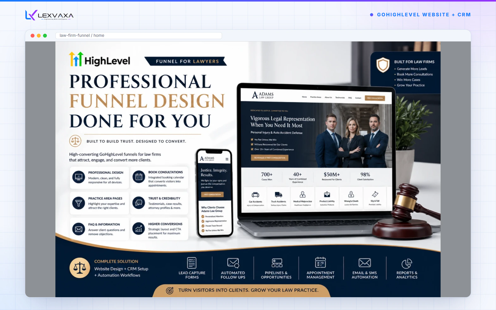

<!-- styled:v2 -->

**A law firm website and CRM in GoHighLevel that turns visitors into booked consultations and follows up with every lead automatically.**

  
  
  
  
  
  
  

  <a href="#overview">Overview</a> ·
  <a href="#key-features">Key features</a> ·
  <a href="#results">Results</a> ·
  <a href="#tech-stack">Tech stack</a>

---

## Overview

A law firm needed a website that turns visitors into booked consultations, plus a CRM to follow up with every lead. Lexvaxa built both in GoHighLevel: practice area pages, attorney profiles, testimonials and FAQs, a consultation booking calendar, CRM pipelines and lead capture workflows, and email follow-ups with client nurture sequences. Screens shown use sample data, so no client records are exposed.

## The challenge

Leads came in through the site but follow-up depended on someone remembering to call or email.

## The solution

A GoHighLevel website connected to CRM pipelines, a booking calendar and automated email and SMS follow-ups.

## Key features

- Practice area pages, attorney profile, testimonials and FAQs
- Consultation booking calendar
- CRM pipelines and lead capture workflows
- Email follow-ups and client nurture sequences
- Automated follow-ups for every new lead

## Results

- One system for the website, lead management and marketing automation, from first visit to booked consultation

## Tech stack

    

## Privacy

Client names and records are confidential. Every screen in this repository uses sample data, and source code that belongs to the client is not published.

## Links

- Case study on Lexvaxa: https://lexvaxa.com/work/ghl-law-firm-website-crm

---

**Built by [Ch Muhammad Samiullah](https://github.com/samiullah156-creator)** · AI Automation Engineer and Full-Stack Developer at [Lexvaxa](https://lexvaxa.com)

⭐ Star this repo if you found it useful

